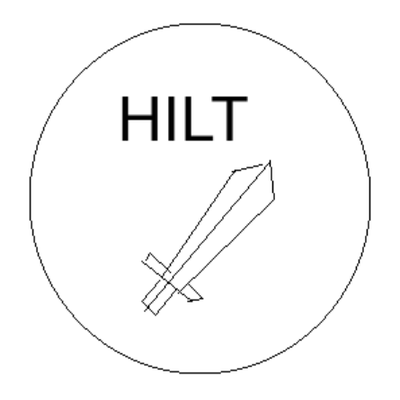

# HILT

Firmware for the Tenstorrent Atlantis SoC System Management Controller
(SMC). Runs on the Rondel based RCPU, the Atlantis SMC.

## Building

Requires `riscv64-unknown-elf-gcc` (for the boot stage), the Zephyr SDK's
RISC-V toolchain (for the runtime, see below), meson, ninja, and Python 3.

Both the boot and runtime stage can be built through meson. For the
runtime stage, meson will call into west to build Zephyr.

```sh
meson setup build --cross-file cross/riscv32-rondel.ini
ninja -C build
```

Build outputs are produced in the build/ directory:

- `hilt.bin` / `hilt.elf` - the firmware targeting RCPU SRAM.
- `hilt.simg` - a simg of hilt.bin
- `nor.img` - 32 MiB NOR flash image
- `hilt-rom.bin` / `hilt-rom.elf` - bootrom image
- `hilt-rom_h.hex` / `hilt-rom_l.hex` - bootrom memory files for HAPs

### Toolchains

The boot stage is compiled with the distro `riscv64-unknown-elf-gcc` named
in `cross/riscv32-rondel.ini`. The Zephyr runtime is compiled with the
`riscv64-zephyr-elf` toolchain from the [Zephyr SDK](
https://github.com/zephyrproject-rtos/sdk-ng/releases), version 1.0.1.
CI builds inside Zephyr's CI container image, which ships the SDK preinstalled;
locally, install the minimal SDK bundle for your host with just that toolchain:

```sh
tar xf zephyr-sdk-1.0.1_linux-x86_64_minimal.tar.xz -C ~
~/zephyr-sdk-1.0.1/setup.sh -t riscv64-zephyr-elf -c
```

## HILT boot stage
The boot stage is a bare-metal C program that can be compiled for
maskrom or SRAM.

## HILT runtime stage

The runtime stage which runs after the boot stage is a Zephyr application:
The application is in src/runtime and built for the `tt_atlantis_evb/tt_atlantis/rcpu`
board target. The SoC and board definitions are under zephyr/, following
the Zephyr directory structure for new SoCs and boards.

## Host unit tests

Unit tests can be run natively on the host running:

```sh
meson setup build-host
meson test -C build-host
```

## Boot test on QEMU

The generated NOR image can be tested on the `tt-atlantis` machine on
Tenstorrent QEMU fork. It requires a QEMU build at ../out. By default,
the ZSBL (qemu/pc-bios/tt-zsbl) will boot first and load HILT from the nor
image before handing off execution to HILT.

```sh
./tests/target/run-qemu-boot.sh
```

To test with the HILT bootrom image instead of ZSBL:

```sh
BOOTROM=build/hilt-rom.bin tests/target/run-qemu-boot.sh
```

## Contributing

See [CONTRIBUTING.md](CONTRIBUTING.md) for information on how to contribute to this project.

## License

This project is licensed under the terms described in:

* [LICENSE](LICENSE) – code license
* [LICENSE_understanding.txt](LICENSE_understanding.txt) – license summary and clarification
* [LICENSE-DOCS](LICENSE-DOCS) – Creative Commons license for all documentation and logos
