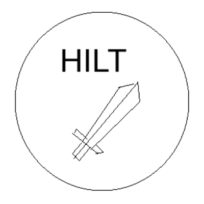

# HILT

## Overiew
HILT is the bootloader for the Tenstorrent Atlantis SoC System Management
Controller (SMC). Runs on the Rondel based RCPU, the Atlantis SMC.

HILT can be compiled to run in maskrom, as hilt-bootrom, or in SRAM, as
the first stage bootloader (FSBL), hilt. hilt-bootrom is not the actual
Atlantis bootrom but the intention is that it is functionaly equivalent
and can be used as a reference project.

### Hardware Support

HILT currently only supports running on the Atlantis platform, qemu or
emulation.

## Using

### Prerequisites

Required tools:

* riscv64-unknown-elf-gcc
* meson
* ninja
* Python 3.

### Building

To build the applicaiton, run the following command:

```sh
meson setup build --cross-file cross/riscv32-rondel.ini
ninja -C build
```

Build outputs are produced in the build/ directory:

- `hilt.bin` / `hilt.elf` - the firmware targeting RCPU SRAM.
- `hilt.simg` - a simg of hilt.bin
- `nor.img` - 32 MiB NOR flash image
- `hilt-rom.bin` / `hilt-rom.elf` - bootrom image
- `hilt-rom_h.hex` / `hilt-rom_l.hex` - bootrom memory files for HAPs
- `platform-fw.simg` - a simg of the platform-fw. Currently this is a
   placeholder binary.

### Host unit tests

Unit tests can be run natively on the host running:

```sh
meson setup build-host
meson test -C build-host
```

### Boot test on QEMU

The generated NOR image can be tested on the `tt-atlantis` machine on
Tenstorrent QEMU fork. It requires a QEMU build at ../out/qemu; set
`QEMU_BUILD` to use a build somewhere else. By default, the ZSBL
(qemu/pc-bios/tt-zsbl) will boot first and load HILT from the nor image
before handing off execution to HILT.

```sh
./tests/target/run-qemu-boot.sh
```

To test with the HILT bootrom image instead of ZSBL:

```sh
BOOTROM=build/hilt-rom.bin tests/target/run-qemu-boot.sh
```

## Contributing

See [CONTRIBUTING.md](CONTRIBUTING.md) for information on how to contribute to this project.

## License

This project is licensed under the terms described in:

* [LICENSE](LICENSE) – code license
* [LICENSE_understanding.txt](LICENSE_understanding.txt) – license summary and clarification
* [LICENSE-DOCS](LICENSE-DOCS) – Creative Commons license for all documentation and logos
